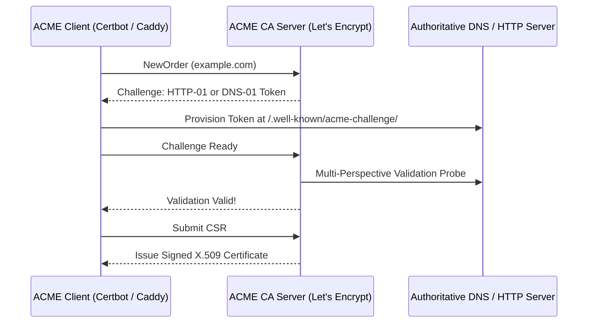

# Security Automation: ACME Protocol (RFC 8555) Architecture

The Automated Certificate Management Environment (ACME) protocol powers Let's Encrypt, automating domain validation and certificate renewal without human intervention.

---

## 1. Multi-Perspective Validation
ACME servers validate challenges from multiple vantage points globally to defeat localized BGP hijacking and DNS cache poisoning.
