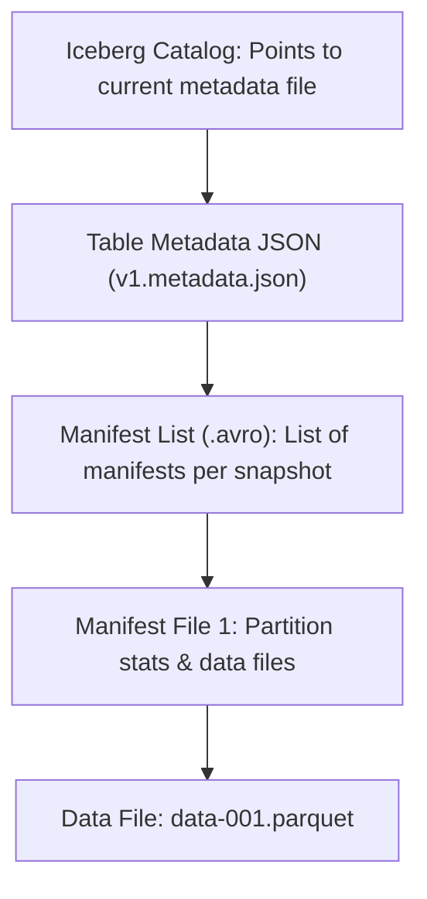

# Apache Iceberg: Table Format & Metadata Trees

Apache Iceberg replaces directory-based table tracking with hierarchical metadata trees, enabling atomic schema evolution, hidden partitioning, and time-travel queries.

---

## 1. Key Capabilities

1. **Snapshot Isolation:** Every write creates an immutable snapshot. Readers query table state as of a specific snapshot without locking writers.
2. **Hidden Partitioning:** Partitions derive automatically from source fields (e.g., `days(event_time)`). Users write queries without referencing synthetic partition columns.
3. **File-Level Pruning:** Manifest files store min/max statistics for every data file, pruning non-matching Parquet files prior to query planning.
