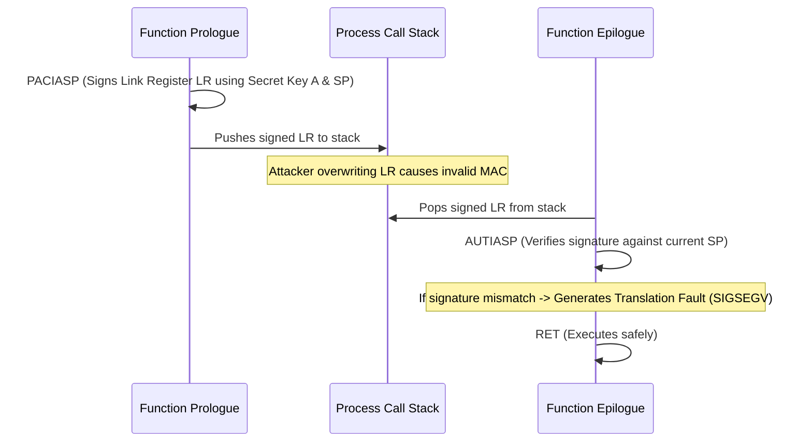

# ARM64: Pointer Authentication (PAC) & Branch Target Identification (BTI)

ARMv8.3-A PAC and ARMv8.5-A BTI stop Return-Oriented Programming (ROP) and Jump-Oriented Programming (JOP) attacks using cryptographic pointer signatures and hardware landing pads.

---

## 1. Hardware Safeguards

* **PAC Bits:** Unused upper bits of 64-bit pointers (bits 63:48) store a Pointer Authentication Code generated via the QARMA / QARMA2 tweakable block cipher.
* **BTI Landing Pads:** Indirect branches (`BR`, `BLR`) can only jump to target instructions explicitly marked as landing pads (`BTI c`, `BTI j`), halting arbitrary JOP gadgets.
