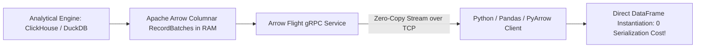

# Data Interoperability: Apache Arrow Flight SQL Protocol

Arrow Flight SQL replaces legacy ODBC/JDBC drivers with high-throughput columnar data transfer using gRPC and Arrow IPC zero-copy binary streams.

---

## 1. Throughput Comparison
- Legacy JDBC: Serializes rows to string/binary tuples, deserializes into client objects (10-50 MB/s).
- Arrow Flight SQL: Streams memory-mapped columnar buffers at network interface line rate (1-5 GB/s).
