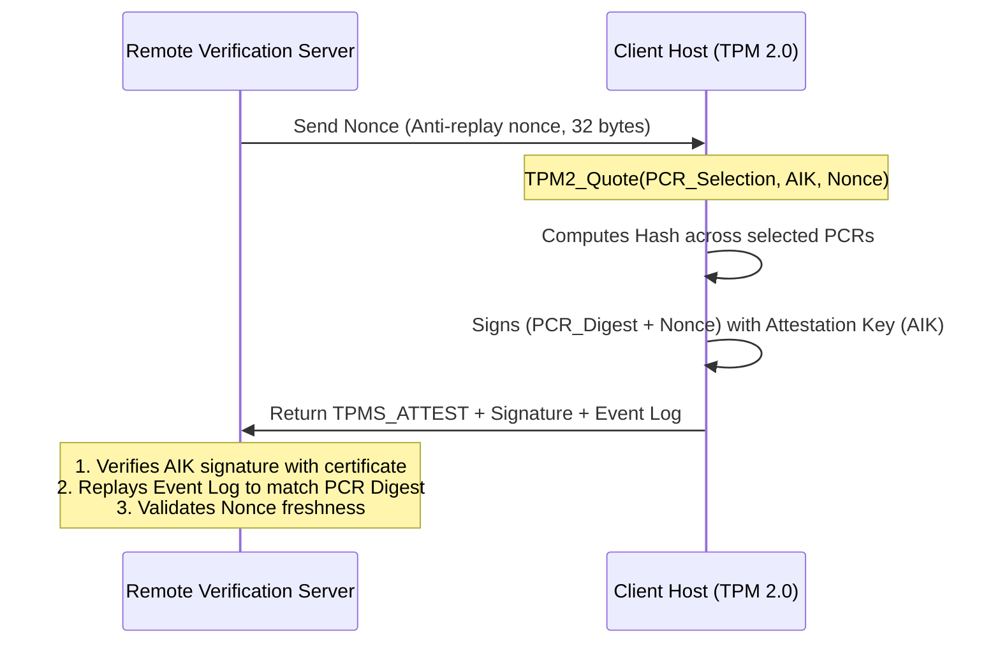

# Hardware Attestation: TPM 2.0 PCR Banks & Remote Quote Verification

Trusted Platform Module (TPM 2.0) chips record cryptographic hashes of platform boot stages inside Platform Configuration Registers (PCRs), providing verifiable evidence of firmware, bootloader, and kernel integrity.

---

## 1. PCR Extension Mathematics

PCR values cannot be set directly; they update exclusively via the cryptographically one-way extend operation:

$$	ext{PCR}_{	ext{new}} = H(	ext{PCR}_{	ext{current}} \parallel 	ext{digest})$$

* **PCR 0-7:** UEFI firmware, ACPI tables, Option ROMs, and Secure Boot configuration.
* **PCR 8-9:** GRUB bootloader parameters and Linux kernel command line.
* **PCR 10:** Linux Integrity Measurement Architecture (IMA) runtime file hashes.
