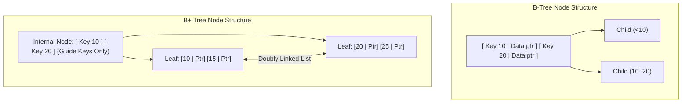

# B-Tree vs B+ Tree Storage Engine Architecture

Relational and KV storage engines rely on B+ Trees for disk-backed indexing.

---

## 1. Fanout Advantage

- Internal nodes hold keys and child pointers only, fitting $300	ext{--}500$ keys per 4KB page.
- Leaf nodes are linked in a bidirectional chain, making range queries $O(K)$ sequential memory scans.
