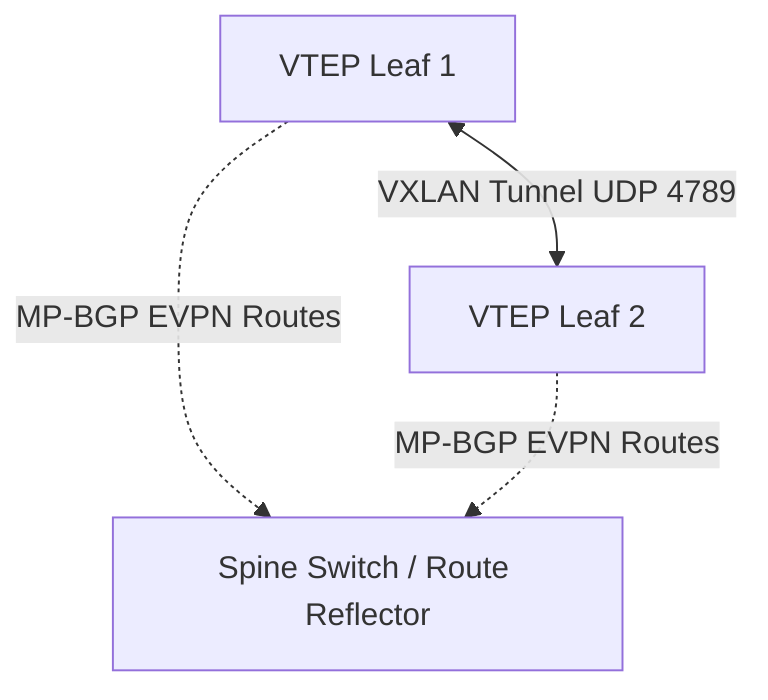

# BGP EVPN & VXLAN Data Center Overlay Architecture

BGP EVPN standardizes control plane route exchange across VXLAN network overlays.

---

## 1. Primary Route Types

- **Type 2 (MAC/IP Advertisement)**: Distributes host MAC and IP bindings to remote VTEPs.
- **Type 3 (Inclusive Multicast)**: Establishes automatic tunnels for broadcast, unknown unicast, and multicast (BUM) traffic without IP multicast in the underlay.
- **Type 5 (IP Prefix)**: Inter-subnet routed prefixes across VRFs.
