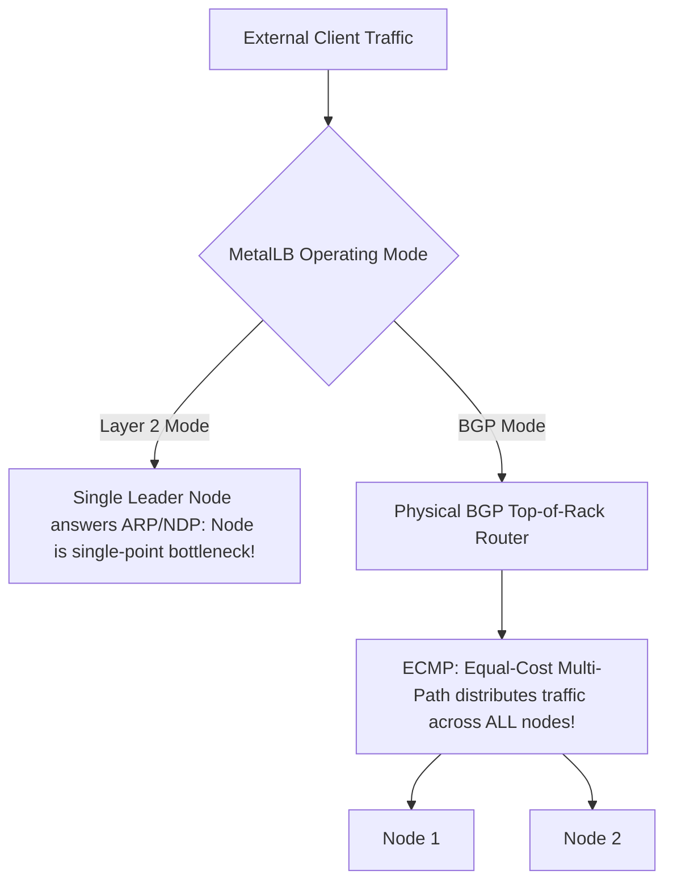

# Bare Metal Networking: MetalLB Load Balancing Architecture

MetalLB assigns external IP addresses to Kubernetes LoadBalancer services on bare-metal clusters without cloud provider load balancers.

---

## 1. BGP Mode Advantage
True load balancing at line rate with zero single-node bottleneck and instant failover via BGP peer keepalive timeouts.
