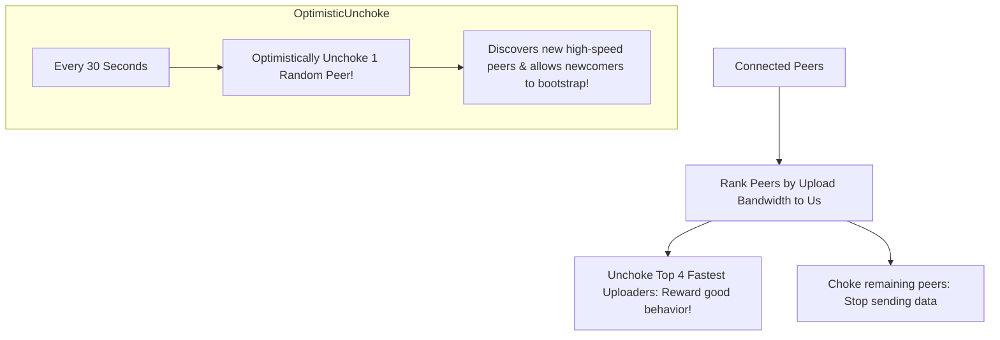

# Peer-to-Peer Economics: BitTorrent Tit-For-Tat Choking Algorithm

BitTorrent incentivizes peer bandwidth sharing through a game-theoretic Tit-For-Tat strategy: unchoking the 4 fastest uploading peers while periodically optimistic unchoking.

---

## 1. Free-Rider Prevention
Peers that throttle their upload speed are choked by the swarm, naturally receiving lower download speeds.
