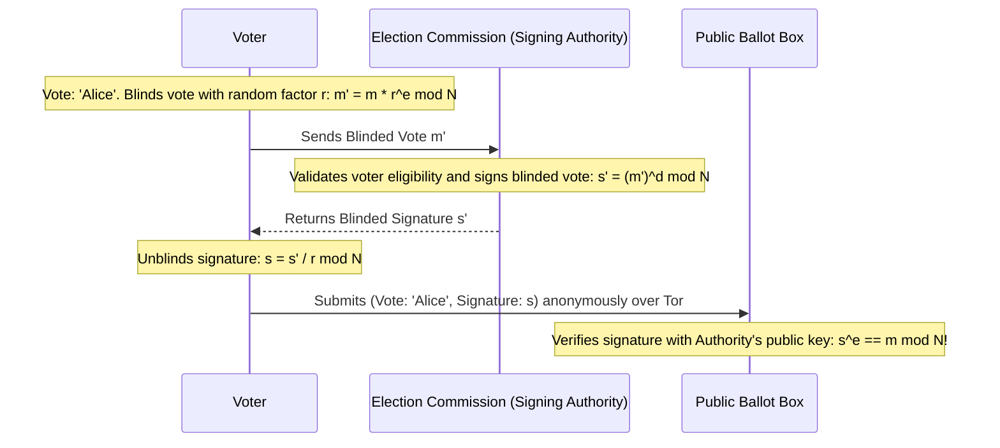

# Cryptographic Privacy: David Chaum Blind Signatures Protocol

Blind signatures allow an authority to sign a document without reading its content, functioning as the digital equivalent of a carbon-paper envelope.

---

## 1. Mathematical Guarantee
The Authority cannot link the unblinded vote in the ballot box back to the original voter because $r$ is uniform and private to the voter.
