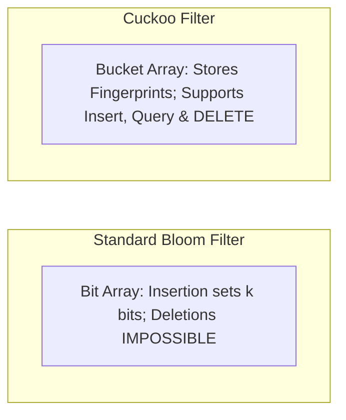

# Advanced Probabilistic Filters: Counting & Cuckoo Filters

Probabilistic data structures answer set membership queries in constant memory with controllable false positive rates.

---

## 1. Comparison

| Feature | Standard Bloom | Counting Bloom | Cuckoo Filter |
|---|---|---|---|
| **Element Deletion** | Unsupported | Supported (4-bit counters) | Supported via fingerprint removal |
| **Memory Efficiency** | High | Low (4x larger bit array) | Highest at low error rates ($<3\%$) |
| **Lookup Invalidation** | Cannot rebuild | Counter decrement | Bucket eviction chain |
