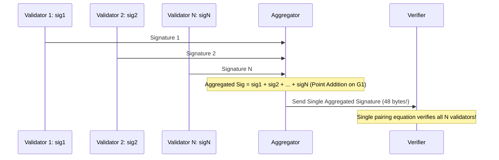

# Consensus Cryptography: BLS12-381 Signature Aggregation

Boneh-Lynn-Shacham (BLS) signatures over pairing-friendly elliptic curves allow thousands of validator signatures to be aggregated into a single 48-byte point.

---

## 1. The Pairing Check
$$e(\sigma_{agg}, g_2) = \prod_{i=1}^{N} e(H(m), pk_i)$$
Enables Ethereum Proof-of-Stake to verify 30,000+ validator votes per 12-second slot with minimal bandwidth overhead.
