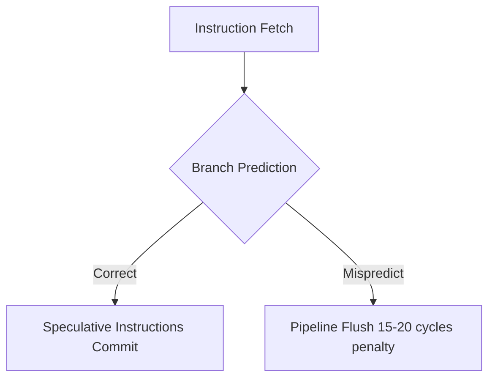

# CPU Branch Prediction & Inter-Processor TLB Shootdowns

Microarchitectural execution pipelining relies on Branch Target Buffers (BTB) and Pattern History Tables (PHT).

---

## 1. TLB Shootdown Mechanics

When one core unmaps or changes permissions of a virtual memory page (`munmap` / `mprotect`), all other cores caching that translation in their Translation Lookaside Buffer (TLB) must invalidate it:
1. Initiating core sends an Inter-Processor Interrupt (IPI).
2. Remote cores halt execution pipeline, enter kernel interrupt handler, invalidate local TLB entry (`invlpg`), and acknowledge IPI.
3. High multi-threaded memory allocation churn causes severe TLB shootdown latency.
