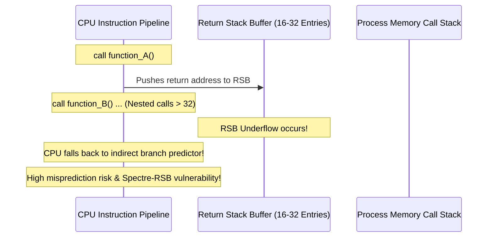

# CPU Internals: Return Stack Buffer (RSB) Speculation

Modern CPUs predict the target of `ret` instructions using a dedicated Return Stack Buffer (RSB). When function call depth exceeds RSB capacity, RSB underflow occurs.

---

## 1. Post-Spectre Padding
Operating systems and hypervisors pad the RSB with 32 benign return entries during context switches to prevent cross-process branch poisoning.
