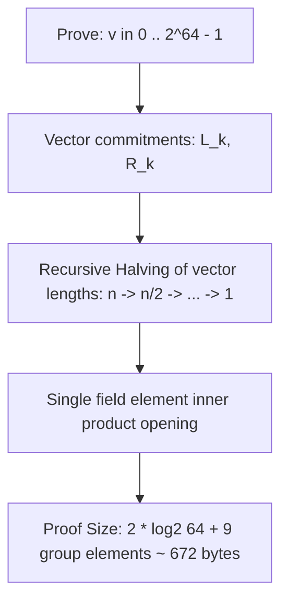

# Bulletproofs: Logarithmic Inner-Product Argument Architecture

Bulletproofs provide short, non-interactive zero-knowledge proofs for arbitrary range assertions ($v \in [0, 2^n - 1]$) with zero trusted setup ceremonies, scaling proof size logarithmically $O(\log n)$.

---

## 1. Recursive Folding Protocol

At each round $k$, prover computes folded vectors $\mathbf{a}', \mathbf{b}'$:
$$\mathbf{a}' = \mathbf{a}_{	ext{low}} \cdot x + \mathbf{a}_{	ext{high}} \cdot x^{-1}$$
$$\mathbf{b}' = \mathbf{b}_{	ext{low}} \cdot x^{-1} + \mathbf{b}_{	ext{high}} \cdot x$$
halving communication costs at every step.
