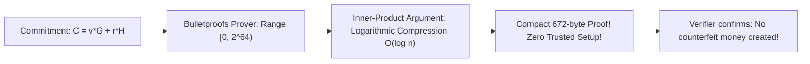

# Zero-Knowledge Arguments: Bulletproofs Range Proofs Architecture

Bulletproofs (used in Monero) prove that a secret committed value lies within a specific numeric range (e.g., $0 \le v < 2^{64}$) to prevent negative-balance inflation without revealing the transaction amount.

---

## 1. Logarithmic Scaling
While traditional range proofs scale linearly $O(n)$ in proof size, Bulletproofs scale logarithmically $O(\log n)$ using recursive inner-product arguments.
