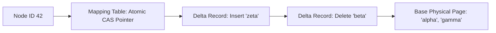

# Database Internals: Microsoft Bw-Tree Lock-Free Architecture

The Bw-Tree (used in Azure DocumentDB and SQL Server Hekaton) provides a latch-free B-Tree that avoids CPU cache invalidation by chaining update deltas and using an atomic Mapping Table.

---

## 1. Core Principles
1. **Append-Only Delta Records:** Updates prepend a delta record to the chain using a single compare-and-swap (CAS) on the mapping table pointer.
2. **Page Consolidation:** When delta chains exceed threshold length, a background worker consolidates them into a fresh contiguous base page.
