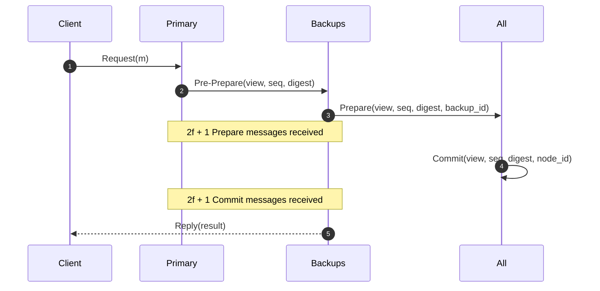

# Practical Byzantine Fault Tolerance (PBFT)

PBFT achieves consensus in asynchronous distributed systems subject to Byzantine (arbitrary/malicious) failures.

---

## 1. Bound $3f + 1$

To tolerate $f$ Byzantine nodes:
$$N \ge 3f + 1$$
Guarantees quorum intersection between any two sets of $2f + 1$ nodes includes at least $f + 1$ honest nodes.
