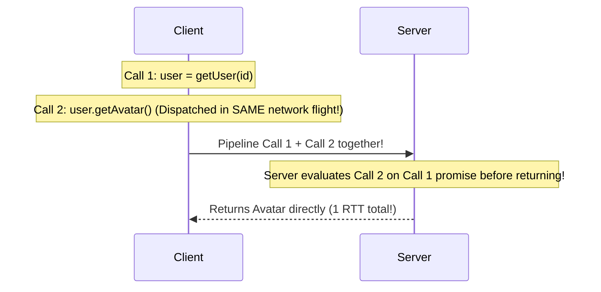

# High-Performance RPC: Cap'n Proto Arena Allocation Architecture

Cap'n Proto (by Kenton Varda) features infinite-speed serialization (memory-identical layout) and Promise Pipelining (Time-Travel RPC).

---

## 1. Promise Pipelining
Eliminates round-trip delays between dependent RPC calls: client pipelines call 2 referencing the unresolved promise of call 1.
