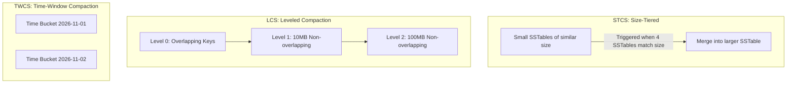

# Apache Cassandra: LSM-Tree Compaction Strategies

Cassandra persists row mutations to disk in immutable Sorted String Tables (SSTables). Compaction merges obsolete row versions to control read amplification, disk amplification, and tombstone accumulation.

---

## 1. Strategy Comparison Matrix

| Strategy | Best Use Case | Read Amplification | Write Amplification | Space Overhead |
|---|---|---|---|---|
| **STCS** | Write-heavy, non-updating workloads. | High | Low | High (up to 50% free space required) |
| **LCS** | Read-heavy, frequent update workloads. | Very Low | High | Low (~10% free space required) |
| **TWCS** | Time-series data with TTL expiration. | Low | Minimal | Minimal |
