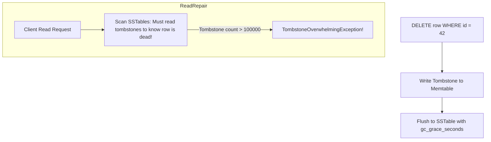

# Distributed Storage: Cassandra Read Repair and Tombstone Overheads

Cassandra does not delete data immediately from SSTables; instead, it writes a deletion marker called a **Tombstone** with a timestamp and GC Grace Period.

---

## 1. GC Grace Seconds
- Tombstones must survive longer than the maximum anticipated node downtime (default 10 days) so that all replicas receive notice of deletion during repair.
