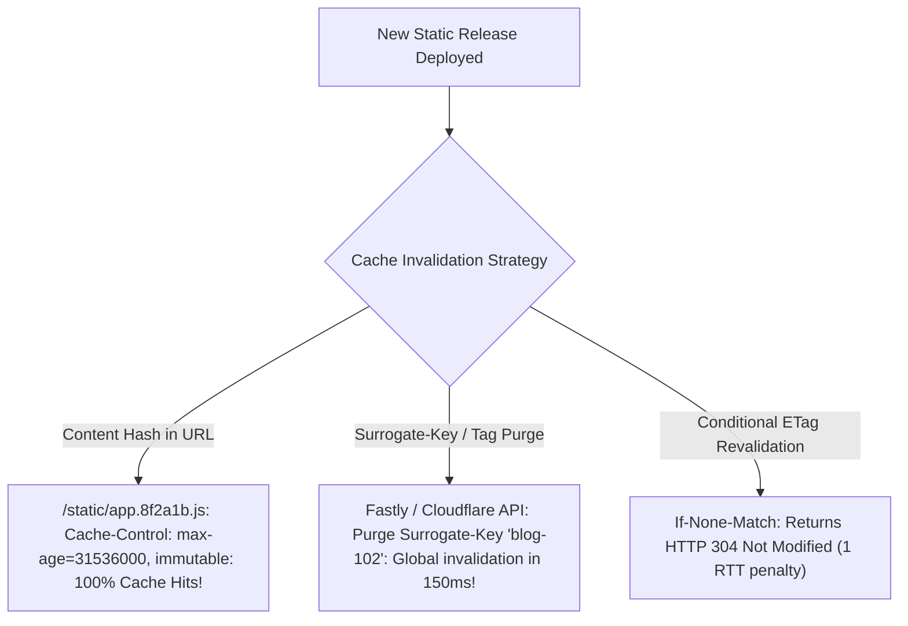

# Web Infrastructure: CDN Cache Invalidation & Stale-While-Revalidate

Managing global CDN edge cache consistency requires balancing instant API purge broadcasts against conditional HTTP validation.

---

## 1. Best Practice
Use immutable content-hashed URLs for static frontend assets (`bundle.[hash].js`) and Surrogate-Keys (Cache-Tags) for dynamic API data.
