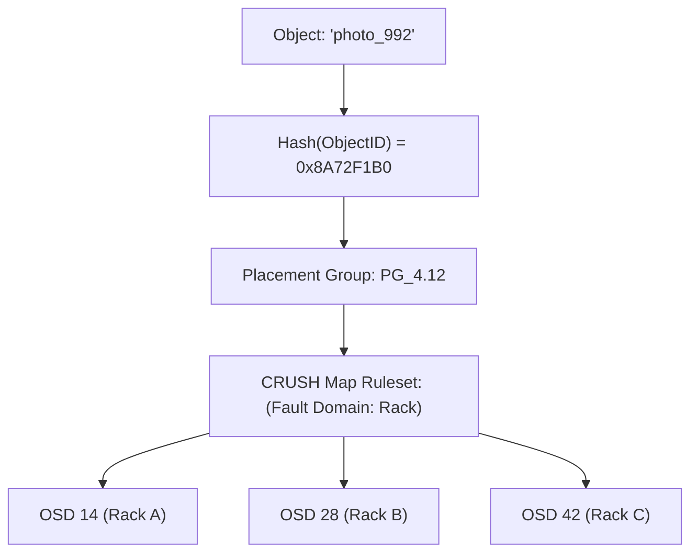

# Distributed Object Storage: Ceph CRUSH Map Placement Algorithm

Ceph eliminates centralized metadata servers (lookup tables) for object placement by calculating storage node locations deterministically using CRUSH (Controlled Replication Under Scalable Hashing).

---

## 1. Hierarchical Cluster Map
CRUSH maps model real-world topology:
$$\text{Root} \rightarrow \text{Datacenter} \rightarrow \text{Row} \rightarrow \text{Rack} \rightarrow \text{Host} \rightarrow \text{OSD}$$
Replicas are placed across isolated fault domains to survive rack/power failure.
