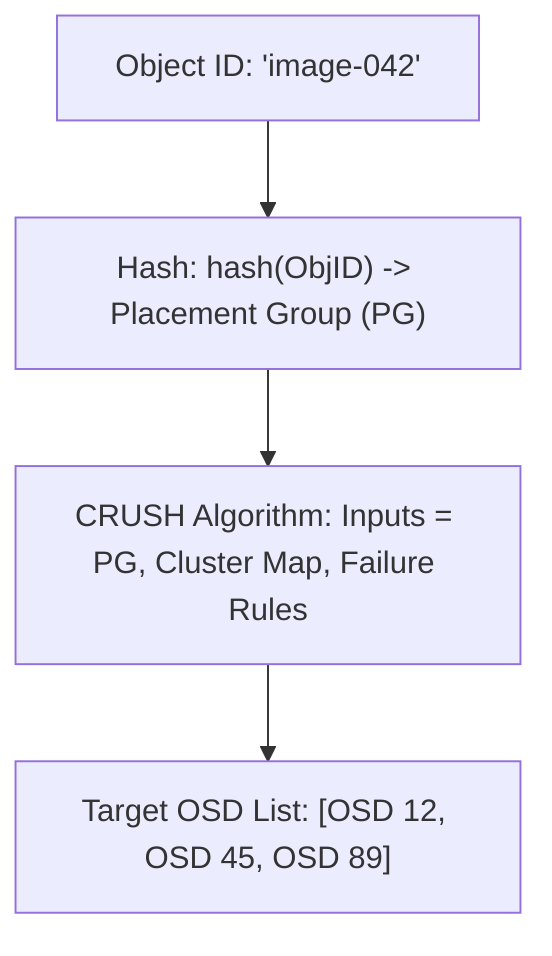

# Ceph: CRUSH Map Algorithmic Object Placement

Ceph abandons centralized metadata lookups by calculating data placement deterministically using the CRUSH (Controlled Replication Under Scalable Hashing) algorithm.

---

## 1. Core Principles

1. **Algorithmic Lookups:** Clients compute the exact storage nodes (OSDs) storing a requested object using local CPU calculations, eliminating metadata server bottlenecks.
2. **Failure Domain Isolation:** CRUSH rules place replica copies across separate failure boundaries (e.g., separate server racks, power supplies, or datacenters).
3. **Minimal Data Migration:** When adding or removing cluster storage disks, CRUSH moves only the minimal fraction of data needed to rebalance the cluster ($1/N$).
