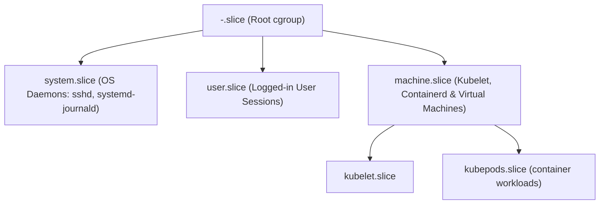

# Linux System Engineering: systemd Slice Hierarchy and Unified cgroups v2

systemd organizes system processes into a unified resource tree using slices, scopes, and services under `/sys/fs/cgroup`.

---

## 1. Memory limits and protection

A `MemoryMax=` limit maps to cgroup v2 `memory.max`. If a cgroup reaches that hard limit and reclaim cannot free enough memory, the kernel invokes the cgroup OOM path; it does not guarantee that unrelated host services are protected from all host-wide memory pressure.

`MemoryMin=` and `MemoryLow=` map to `memory.min` and `memory.low`. They make a cgroup's memory less likely to be reclaimed when the host is under pressure. `MemoryMin=` is stronger; `MemoryLow=` can still be reclaimed to avoid an OOM when no other reclaimable memory remains. Set matching protection on ancestor slices so the child allocation is effective, and avoid overcommitting protected memory.

Use hard limits to bound a workload and protection values to prioritize critical services. Neither removes the need to leave headroom for the host and account for kernel memory.

## References

- systemd, [Resource control settings](https://www.freedesktop.org/software/systemd/man/latest/systemd.resource-control.html).
- Linux kernel, [Control Group v2 memory interface](https://docs.kernel.org/admin-guide/cgroup-v2.html#memory-interface-files).
