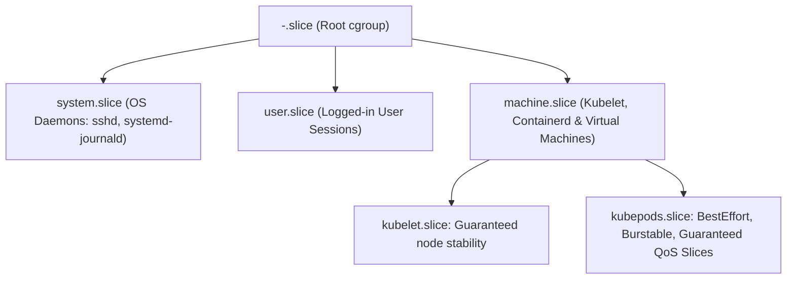

# Linux System Engineering: systemd Slice Hierarchy and Unified cgroups v2

systemd organizes all system processes into a unified resource tree using slices, scopes, and services under `/sys/fs/cgroup`.

---

## 1. OOM Protection via Hierarchy
Memory exhaustion in `kubepods.slice` triggers OOM termination inside container workloads without ever starving core system daemons in `system.slice`.
