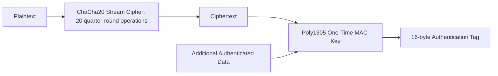

# Symmetric Encryption: ChaCha20-Poly1305 AEAD Pipeline

ChaCha20-Poly1305 provides high-throughput Authenticated Encryption with Associated Data (AEAD), outperforming AES on mobile and embedded devices lacking AES-NI hardware instructions.

---

## 1. Resistance to Side-Channel Attacks
ChaCha20 utilizes exclusively ARX operations (Add-Rotate-XOR) on 32-bit CPU registers:
- Zero data-dependent table lookups (eliminates cache-timing vulnerabilities inherent to naive software AES).
