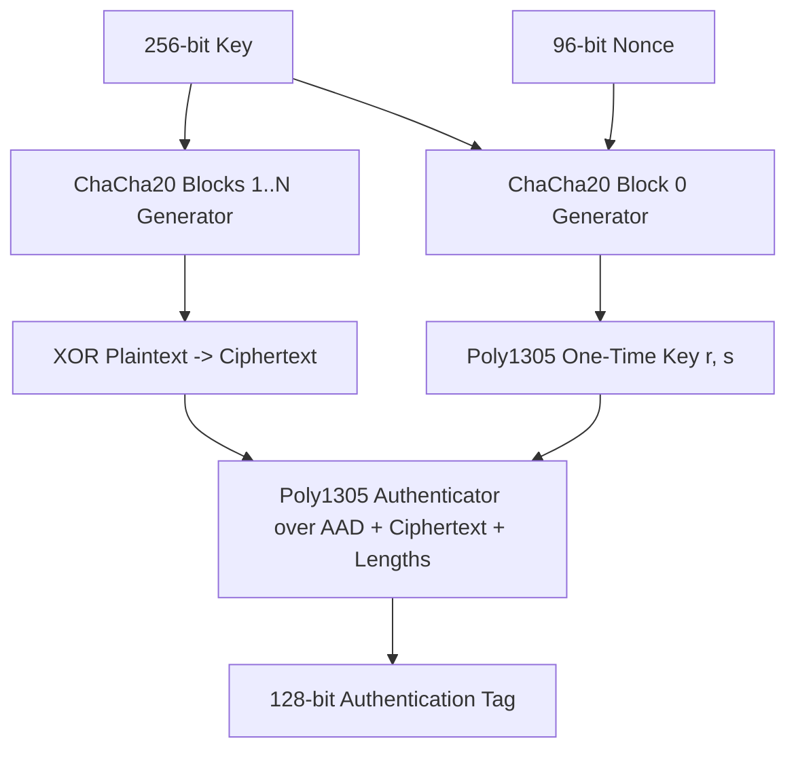

# RFC 8439 ChaCha20-Poly1305 AEAD Architecture

ChaCha20-Poly1305 provides high-throughput authenticated encryption with associated data (AEAD) designed for microprocessors lacking hardware AES instructions.



---

## 1. ChaCha20 Quarter-Round Equation

Operating on a $4 	imes 4$ matrix of 32-bit unsigned integers:
```c
#define QR(a, b, c, d) \
    a += b; d ^= a; d = ROTL32(d, 16); \
    c += d; b ^= c; b = ROTL32(b, 12); \
    a += b; d ^= a; d = ROTL32(d, 8);  \
    c += d; b ^= c; b = ROTL32(b, 7);
```
20 rounds alternate 4 column-rounds and 4 diagonal-rounds, providing 256-bit security against differential and linear cryptanalysis.
