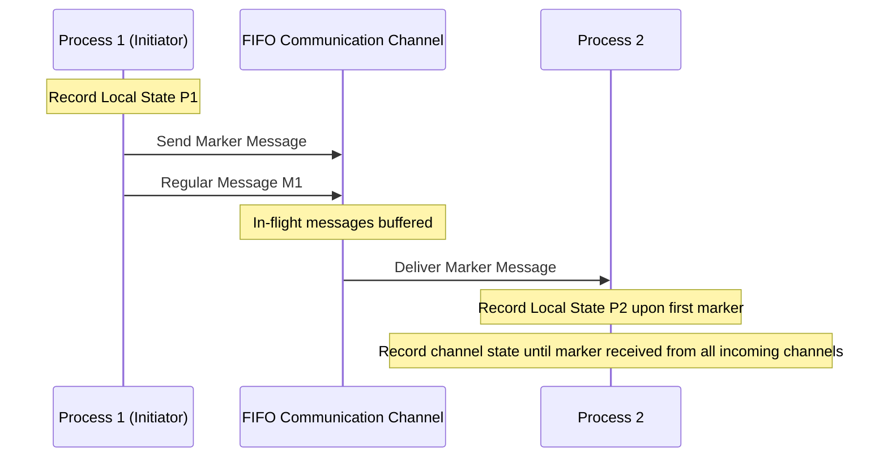

# Distributed Systems: Chandy-Lamport Distributed Snapshot

The Chandy-Lamport algorithm captures a consistent global state (state of processes and in-flight channel messages) without pausing distributed execution.

---

## 1. Fundamental Assumptions
- Channels are FIFO, reliable, and unidirectional.
- Processes do not crash during snapshot collection.
