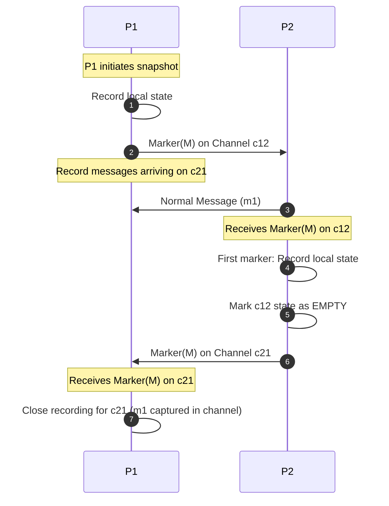

# Chandy-Lamport Distributed Snapshot Algorithm

Captures consistent global states in distributed systems without pausing active message processing or requiring synchronized clocks.

---

## 1. Assumptions

- FIFO, lossless, and directed communication channels between nodes.
- Strongly connected process graph.
