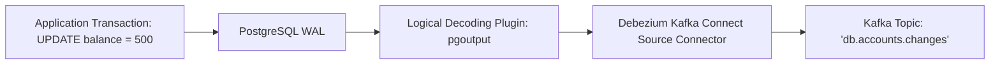

# Data Engineering: Debezium CDC and PostgreSQL Logical Decoding

Change Data Capture streams every insert, update, and delete event from database write-ahead logs into Apache Kafka with zero query overhead.

---

## 1. Exact-Once Invariants
Uses database Log Sequence Numbers (LSN) as Kafka offsets: if the connector restarts, it resumes reading from the exact confirmed LSN without duplicating change events.
