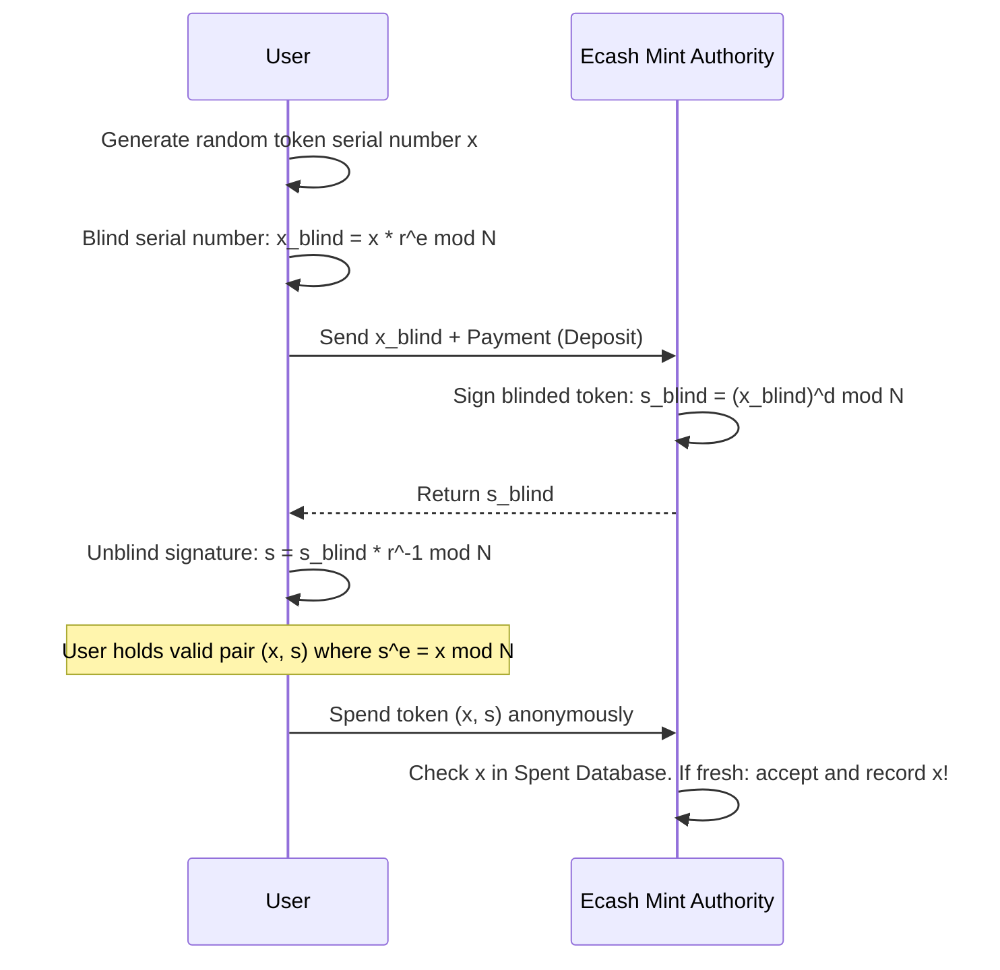

# Chaumian Blind Signatures & Ecash Mint Architecture

David Chaum's blind signature protocol allows users to obtain cryptographic token signatures from a central mint without revealing the serial numbers, providing cryptographic unlinkability.

---

## 1. Anonymity Guarantee

The mint cannot correlate the blinded token $x \cdot r^e \pmod N$ observed during minting with the unblinded token $x$ submitted during spending.
