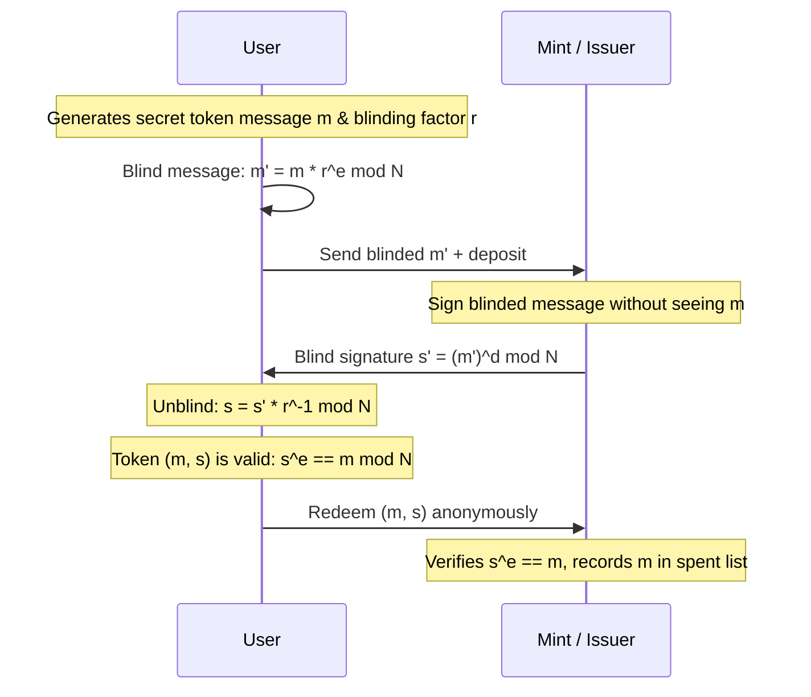

# Chaumian Blind Signatures & Cryptographic e-Cash

David Chaum's blind signature protocol allows a user to obtain a signature from an issuer without disclosing the message content, creating untraceable digital bearer tokens.

---

## 1. RSA Blind Signature Protocol

* **Key Setup:** RSA public key $(e, N)$, private key $d$.
* **Blinding:** User selects random $r \in \mathbb{Z}_N^*$:
  $$m' = m \cdot r^e \pmod N$$
* **Signing:** Mint signs blinded message:
  $$s' = (m')^d = (m \cdot r^e)^d = m^d \cdot r^{e \cdot d} = m^d \cdot r \pmod N$$
* **Unblinding:** User removes blinding factor:
  $$s = s' \cdot r^{-1} = m^d \cdot r \cdot r^{-1} = m^d \pmod N$$
* **Verification:** Anyone verifies $s^e \equiv m \pmod N$. Mint cannot link $(m, s)$ to the withdrawal session where $m'$ was signed.
