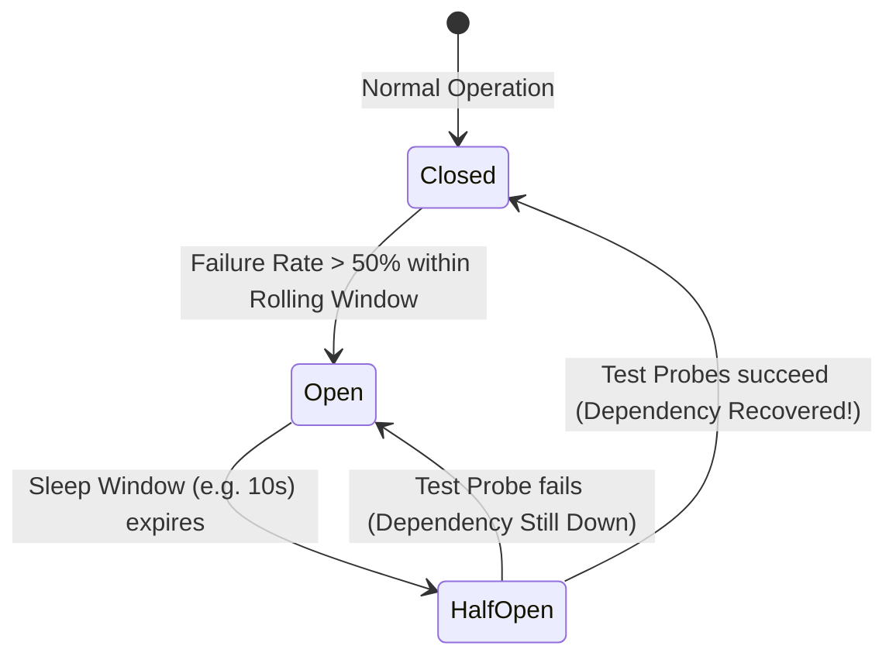

# Fault Tolerance: Circuit Breaker Pattern State Machine

Circuit breakers prevent cascading failures across microservices by cutting off traffic to failing downstream dependencies.

---

## 1. Failure Invariant
In the **Open** state, calls fail fast immediately without waiting for timeouts or tying up thread pool execution slots.
