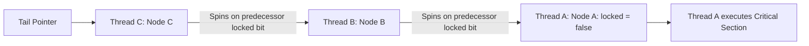

# Craig, Landin, and Hagersten (CLH) Queue Lock Architecture

CLH locks provide FIFO spinlock fairness with minimal memory footprint by having waiting threads spin on their predecessor's node status rather than their own.

---

## 1. Thread Handoff Protocol

When Thread A leaves the critical section, it clears its own `locked` flag. Thread B, which was polling Thread A's node in its local cache, detects the change and enters the critical section immediately.
