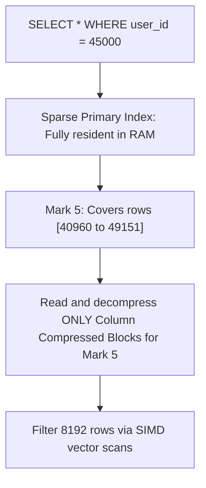

# Columnar Analytics: ClickHouse MergeTree Sparse Index Architecture

Unlike traditional B-Trees that index every single row, ClickHouse stores one primary index entry for every 8,192 rows (one index mark).

---

## 1. RAM Footprint
A ClickHouse table containing 10 billion rows has only ~1.2 million index marks, fitting its entire primary index inside just a few megabytes of RAM.
