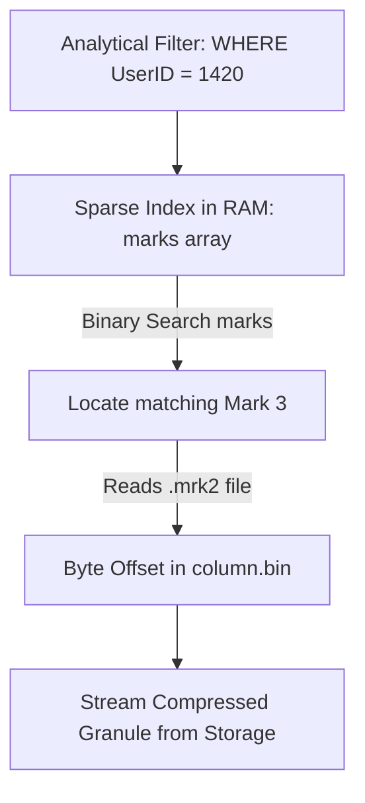

# ClickHouse MergeTree: Sparse Primary Index Architecture

ClickHouse organizes petabyte-scale analytical tables using columnar parts with sparse primary indexes, storing one index mark every 8,192 physical rows (granule) to fit the entire table index into RAM.

---

## 1. Storage Components

* `data.bin`: Compressed column data organized by granule chunks.
* `data.mrk2`: Marks index mapping index records to exact byte offsets inside compressed blocks.
* `primary.idx`: Continuous array of primary key values extracted every `index_granularity` rows.
