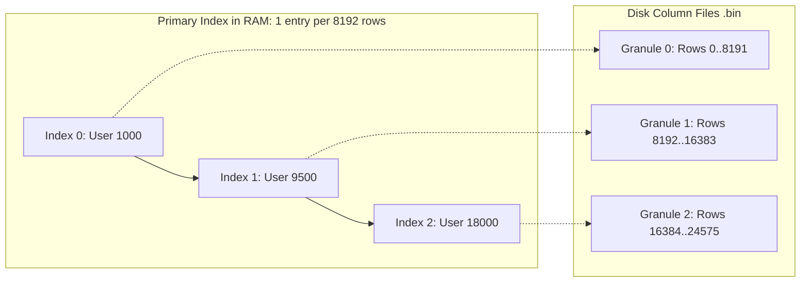

# ClickHouse: Sparse Primary Indexing & MergeTree Engine

Unlike traditional B-Tree databases that index every row, ClickHouse MergeTree tables use sparse indexing with granular marks to support petabyte-scale analytical queries.

---

## 1. Key Invariants

1. **Granule Sizing:** Default index granularity is 8192 rows. The primary index stores one entry per granule, fitting hundreds of millions of rows into a few megabytes of RAM.
2. **Skipping Indexes:** Secondary min-max, set, and Bloom filter indexes discard irrelevant granules before fetching column data files from disk.
3. **Sorting Key Selection:** Columns with lower cardinality must precede high-cardinality keys in the `ORDER BY` tuple to maximize compression and range pruning.
