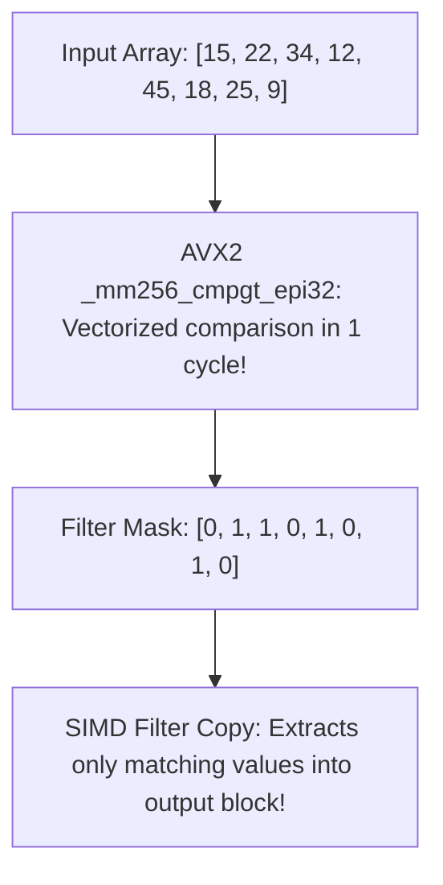

# OLAP Query Engines: ClickHouse Vectorized SIMD Filter Masks

Traditional row-based databases evaluate filter predicates (`WHERE age > 18`) row-by-row via virtual function calls. ClickHouse generates compact 8-bit boolean byte vectors.

---

## 1. Zero Branch Mispredictions
Eliminates branching instructions (`if / else`) completely from the inner loop, saturating CPU instruction pipelines at line rate.
