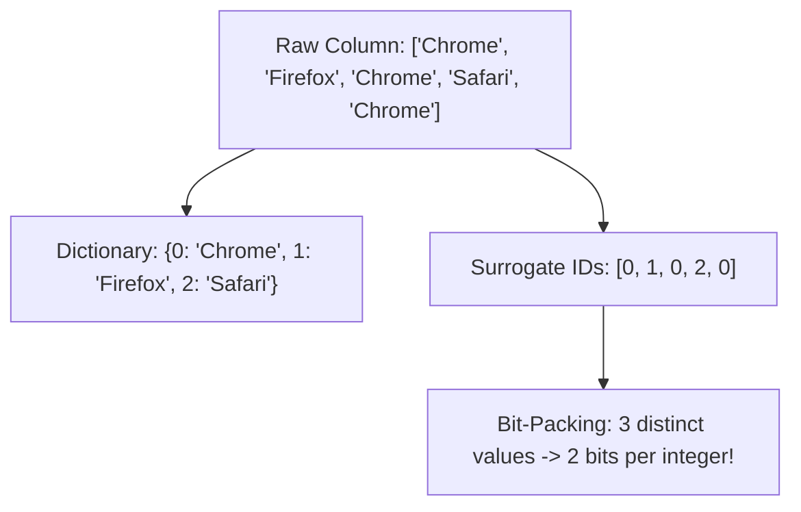

# Storage Engines: Columnar Dictionary Encoding and Bit-Packing

Column-oriented analytical databases (ClickHouse, Snowflake, DuckDB) compress repeating values into compact surrogate keys using dictionary tables and integer bit-packing.

---

## 1. Vectorized Execution Advantage
Compressed 2-bit values can be unpacked in batches using SIMD AVX-512 vector instructions, processing billions of rows per second in L1 cache.
