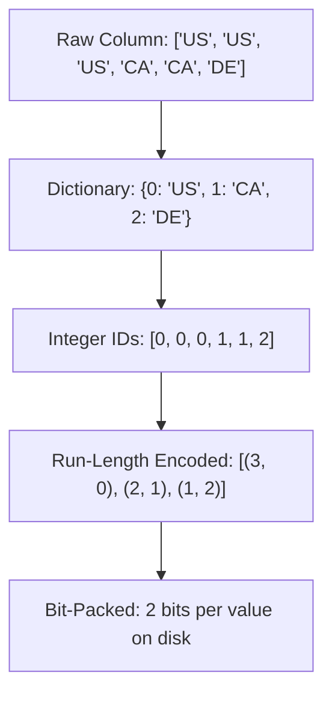

# Columnar Compression: Dictionary, RLE, and Bit-Packing

Analytical storage engines (Apache Parquet, ORC, Apache Arrow) compress homogenous column vectors by exploiting data clustering, cardinality, and bit-level alignment.

---

## 1. Encoding Algorithms

* **Run-Length Encoding (RLE):** Collapses consecutive identical entries into count-value pairs; ideal for pre-sorted low-cardinality keys.
* **Delta Encoding:** Stores difference between successive values ($v_i - v_{i-1}$); optimal for monotonically increasing timestamps and IDs.
* **Bit-Packing:** Uses only $\lceil \log_2(\max) \rceil$ bits instead of full 32-bit or 64-bit machine words.
