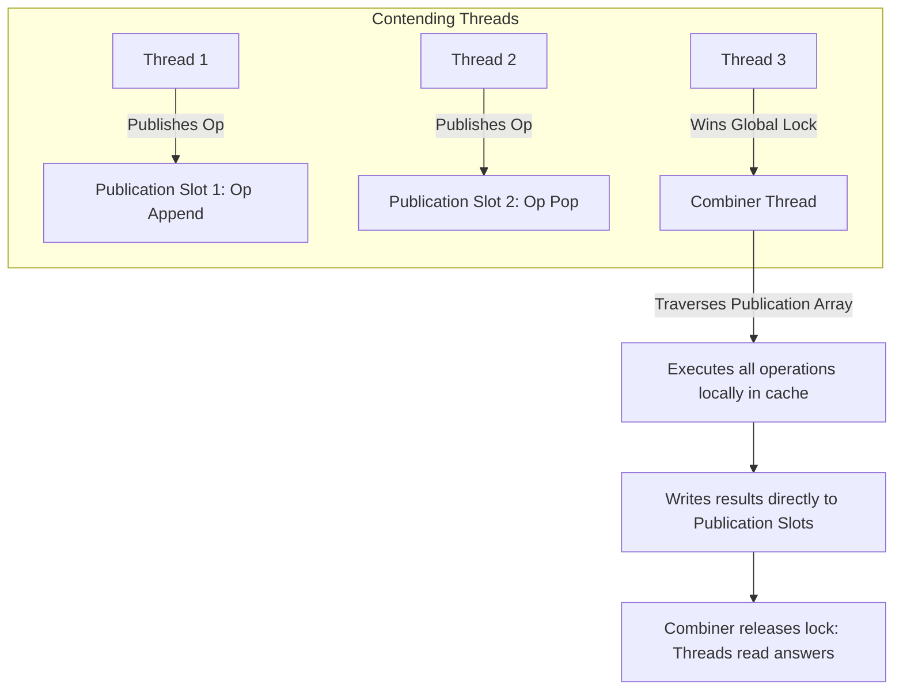

# Concurrency: Flat Combining Synchronization Architecture

Flat Combining reduces cache-line contention on shared data structures by designating one contending thread as the Combiner, which batches and executes operations on behalf of all peer threads.

---

## 1. Operating Mechanics

1. **Publication Array:** Contending threads write their requested operations into thread-local slots within a shared publication list.
2. **Combiner Election:** The first thread to acquire the global spinlock becomes the Combiner; all other threads sleep or spin on their local publication slot response fields.
3. **Single Cache Domain:** The Combiner iterates through the array, performing all queued mutations sequentially inside its private L1/L2 cache without cross-core cache invalidation traffic.
