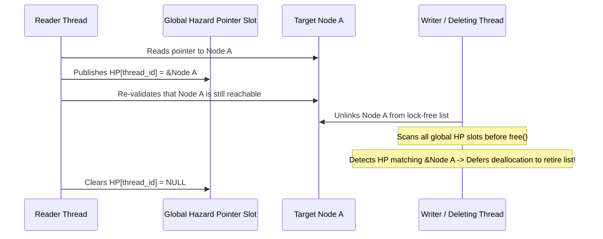

# Concurrency: Hazard Pointers & Lock-Free Memory Safety

Hazard Pointers provide lock-free safe memory reclamation by allowing reader threads to publish pointers to active nodes, preventing writer threads from deallocating memory currently being read.

---

## 1. Algorithm Invariants

1. **Publish Before Dereference:** A reader must write the target address into its hazard pointer slot and issue a memory fence (`atomic_thread_fence(memory_order_seq_cst)`) before reading node data.
2. **Re-Validation Check:** The reader must verify that the node was not unlinked by a writer immediately prior to the hazard pointer publication.
3. **Bounded Memory:** Unlike EBR, hazard pointers guarantee bounded memory consumption even if a single reader thread stalls indefinitely inside a critical section.
