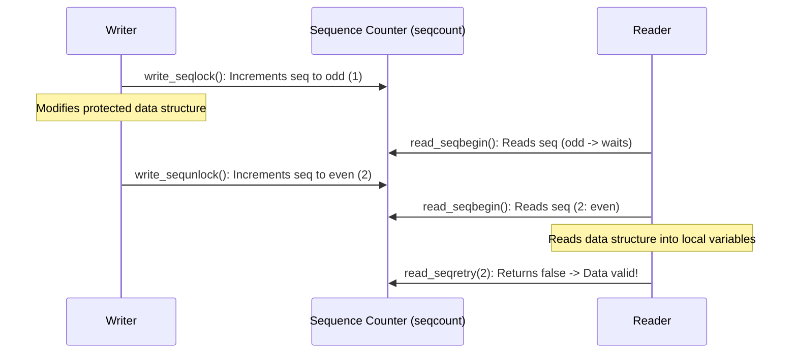

# Linux Kernel: Sequential Locks (seqlock) & Reader Scalability

Sequential locks protect small, frequently read data structures (e.g., `jiffies`, `xtime`) by allowing writers to proceed without blocking readers, while readers validate consistency using sequence numbers.

---

## 1. Protocol Invariants

1. **Sequence State Semantics:**
   - **Even Value:** No writer is currently modifying the data; data is consistent.
   - **Odd Value:** A writer is actively modifying the data; readers must spin or retry.
2. **Reader Retry Loop:** Readers never block writers. If a reader detects `read_seqretry(old_seq) == true`, it simply loops and re-reads the payload.
3. **No Pointer Dereferencing:** Seqlocks cannot protect data containing dynamically allocated pointers, as writers could free memory while a reader is traversing it (causing `SIGSEGV`).
