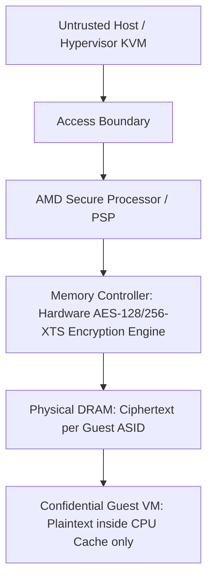

# Confidential Computing: AMD SEV-SNP & Intel TDX

Confidential computing shields virtual machines and memory enclaves from compromised host hypervisors, cloud operators, and physical bus-interception attacks via memory encryption engines and hardware attestation.

---

## 1. Security Guarantee Matrix

| Attack Vector | Standard VM | AMD SEV-ES | AMD SEV-SNP / Intel TDX |
|---|---|---|---|
| **DRAM Bus Snooping** | Vulnerable | Protected (Memory encryption) | Protected (AES-XTS encryption) |
| **Hypervisor RAM Inspection** | Vulnerable | Protected | Protected |
| **CPU Register Dumping** | Vulnerable | Protected (VMSA encryption) | Protected |
| **Page Table Manipulation** | Vulnerable | Vulnerable | **Protected (Reverse Map Table / RMP)** |
| **Memory Replay / Remapping** | Vulnerable | Vulnerable | **Protected (Integrity checks)** |
| **Remote Cryptographic Attestation** | No | Basic | **Hardware-signed Attestation Report** |
