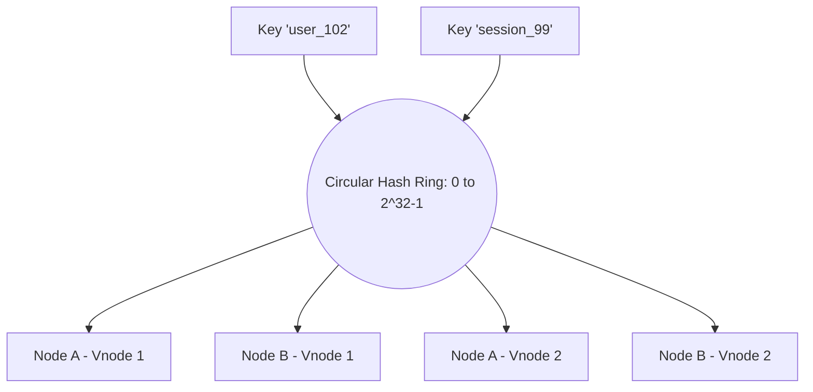

# Distributed Caching: Consistent Hashing with Virtual Nodes

Consistent hashing minimizes key redistribution when cache nodes join or leave, mapped across a continuous circular hash ring ($[0, 2^{32}-1]$).

---

## 1. Google Bounded-Load Variant
Standard consistent hashing can result in hotspot nodes. The Mirrokni et al. bounded-load algorithm enforces:
$$\text{Load}(Node) \le (1 + \epsilon) \cdot \text{AverageLoad}$$
If a target node is above the bound, the key walks clockwise to the next available replica.
