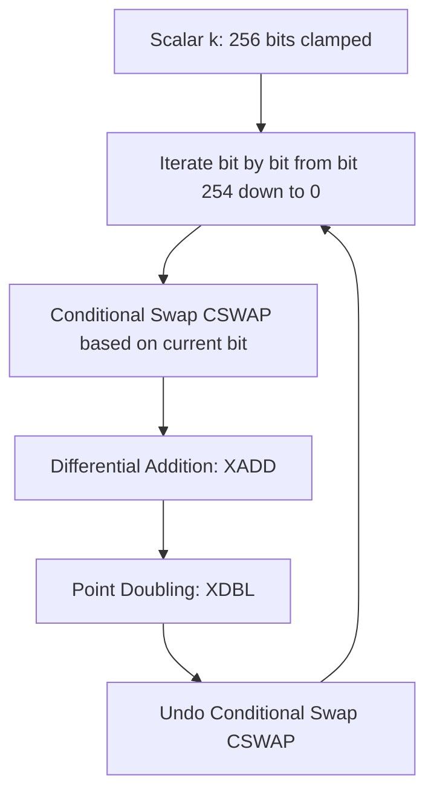

# Constant-Time Montgomery Ladder Architecture

The Montgomery Ladder computes scalar multiplication $Q = [k]P$ on Montgomery curves (Curve25519 / X25519) using only $X$- and $Z$-coordinates, maintaining strictly uniform memory access and branch patterns.



---

## 1. Branchless Conditional Swap (`CSWAP`)

```c
void cswap(uint32_t b, felem *p, felem *q) {
    uint32_t mask = -b; // 0xFFFFFFFF if b=1, 0x00000000 if b=0
    for (int i = 0; i < 5; ++i) {
        uint32_t dummy = mask & (p->v[i] ^ q->v[i]);
        p->v[i] ^= dummy;
        q->v[i] ^= dummy;
    }
}
```
