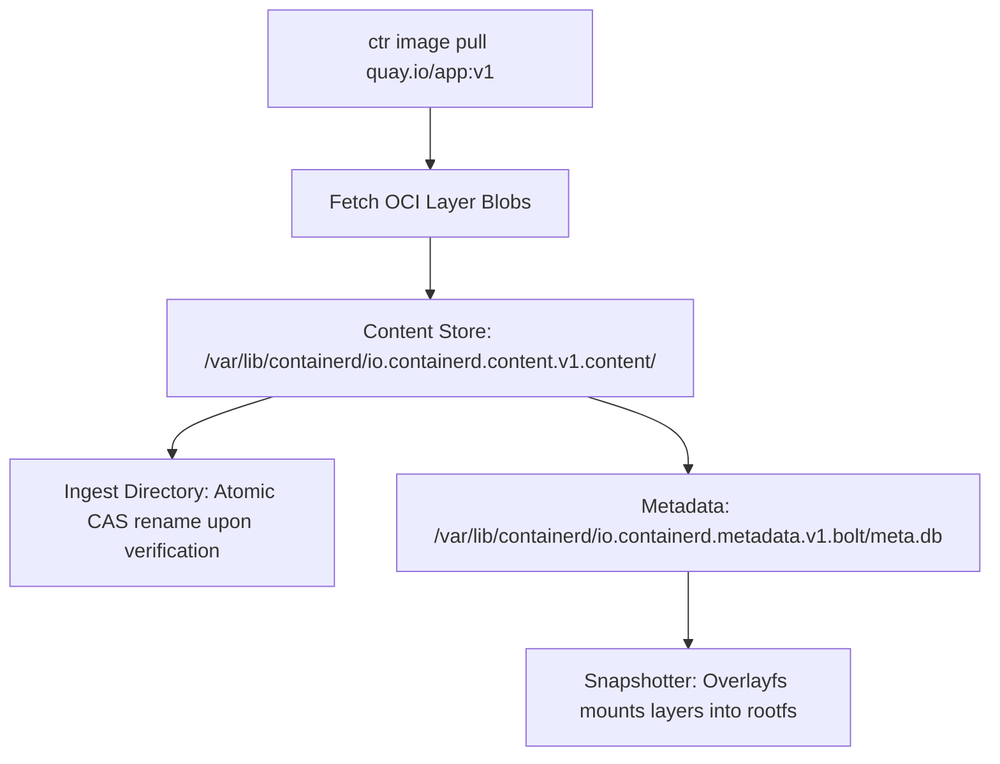

# Container Internals: containerd Content Store Architecture

containerd stores immutable OCI image blobs in a content-addressable storage engine indexed by SHA-256 digests.

---

## 1. Content Addressability
Every layer is identified strictly by its cryptographic hash (`sha256:...`), guaranteeing deduplication across distinct container images sharing common base layers.
