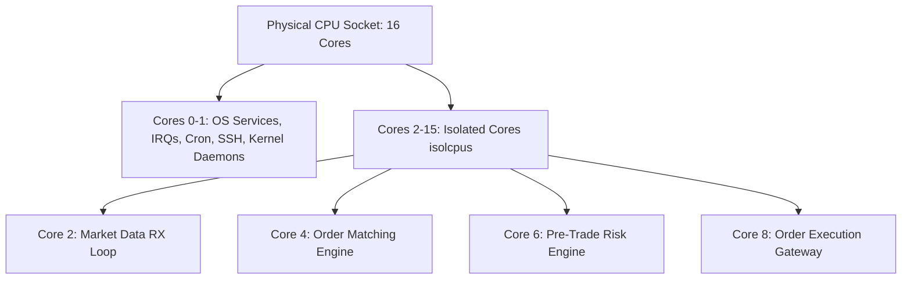

# CPU Core Pinning, isolcpus & Thread Affinity

Operating system scheduler context switches introduce unpredictable jitter. Kernel isolation parameters and thread affinity pin trading processes to dedicated cores.



---

## 1. Kernel Bootloader Parameters (`/etc/default/grub`)

```text
GRUB_CMDLINE_LINUX="isolcpus=2-15 nohz_full=2-15 rcu_nocbs=2-15 intel_idle.max_cstate=0 processor.max_cstate=0 idle=poll mce=ignore_ce"
```

- `isolcpus=2-15`: Removes cores 2 through 15 from the general Linux scheduler domain.
- `nohz_full=2-15`: Disables the periodic scheduler timer tick when only one runnable task exists on the core.
- `rcu_nocbs=2-15`: Offloads Read-Copy-Update callback processing to non-isolated cores (Cores 0–1).
- `intel_idle.max_cstate=0`: Prevents CPU cores from entering power-saving sleep states (C-states).

---

## 2. Setting Thread Affinity Programmatically

```cpp
#define _GNU_SOURCE
#include <pthread.h>
#include <sched.h>
#include <stdexcept>

void pin_thread_to_core(int core_id) {
    cpu_set_t cpuset;
    CPU_ZERO(&cpuset);
    CPU_SET(core_id, &cpuset);

    pthread_t current_thread = pthread_self();
    int rc = pthread_setaffinity_np(current_thread, sizeof(cpu_set_t), &cpuset);
    if (rc != 0) {
        throw std::runtime_error("Failed to pin thread to CPU core");
    }
}
```
