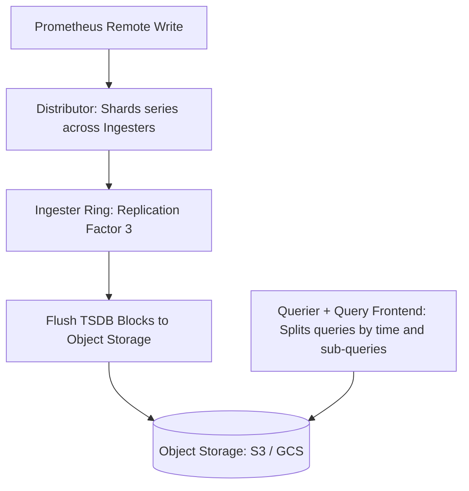

# Cloud-Scale Metrics: Grafana Mimir Architecture

Grafana Mimir provides horizontally scalable, multi-tenant long-term storage for Prometheus metrics, capable of ingesting 1 billion active series.

---

## 1. Query Splitting & Caching
The Query Frontend splits large time range queries into 1-day sub-queries, executes them in parallel across worker pools, and caches immutable results.
